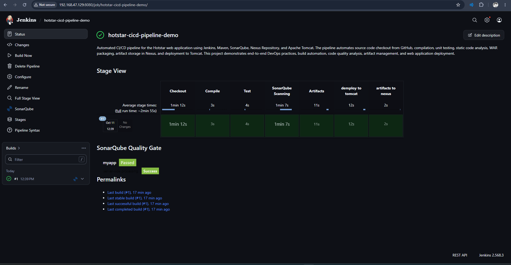
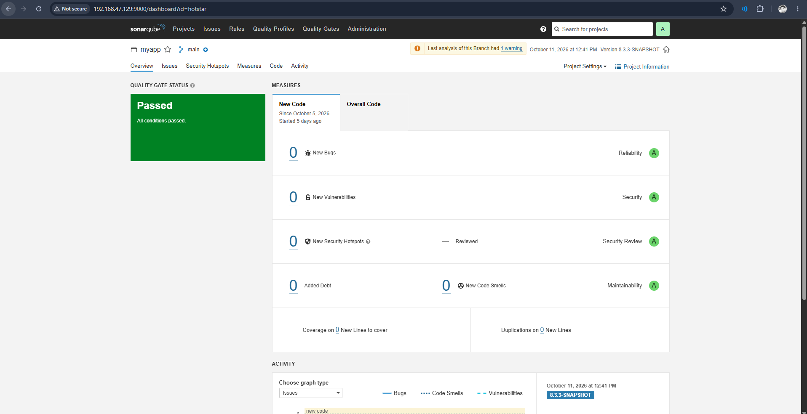
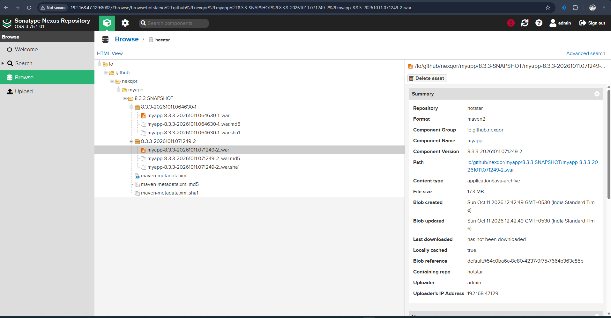
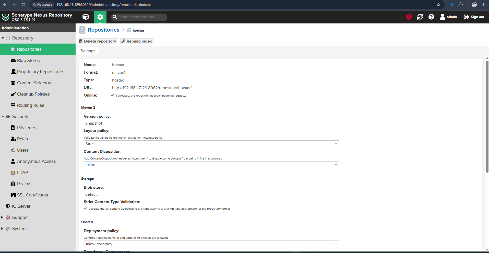
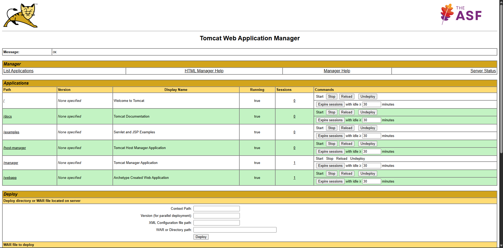
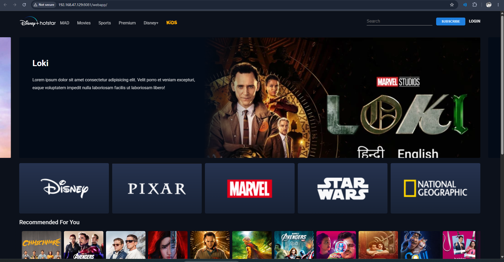
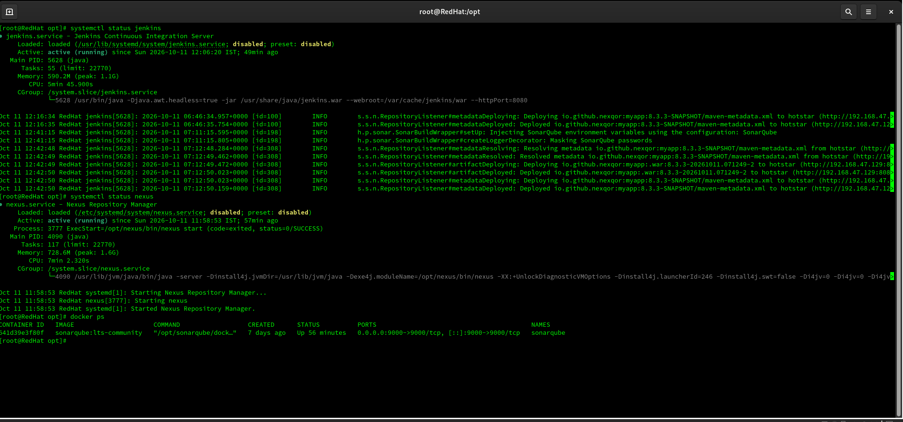
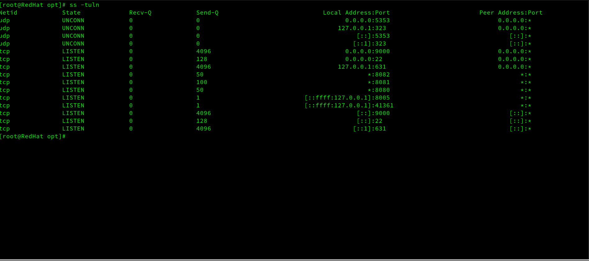

# Hotstar CI/CD Pipeline Demo

Automated CI/CD pipeline for a Hotstar clone web application built and deployed entirely on a **local RedHat VM** using Jenkins, Maven, SonarQube, Nexus Repository, and Apache Tomcat.

---

## 🖥️ Infrastructure

All services run on a single **RedHat Linux VM** (local machine).

| Service       | Port   | How it runs         |
|---------------|--------|---------------------|
| Jenkins       | 8080   | systemd service     |
| Tomcat        | 8081   | systemd service     |
| Nexus         | 8082   | systemd service     |
| SonarQube     | 9000   | Docker container    |

**VM IP:** `192.168.47.129`

---

## 🔄 Pipeline Stages

```
Checkout → Compile → Test → SonarQube Scanning → Artifacts → Deploy to Tomcat → Artifacts to Nexus
```

| Stage               | Tool          | Time     |
|---------------------|---------------|----------|
| Checkout            | Git / GitHub  | ~1m 12s  |
| Compile             | Maven         | ~3s      |
| Test                | Maven / JUnit | ~4s      |
| SonarQube Scanning  | SonarQube     | ~1m 7s   |
| Artifacts (Package) | Maven WAR     | ~11s     |
| Deploy to Tomcat    | Tomcat9 Plugin| ~12s     |
| Artifacts to Nexus  | Nexus Plugin  | ~2s      |

**Total run time: ~2 min 55s** ✅

---

## 📁 Project Structure

```
hotstar-cicd-pipeline/
├── pom.xml                        # Maven build config
├── screenshots/                   # Pipeline proof screenshots
│   ├── jenkins.png                # Jenkins pipeline - all stages passed
│   ├── sonarqube.png              # SonarQube quality gate - Passed
│   ├── nexus.png                  # Nexus repository settings
│   ├── nexus-war-file-store.png   # WAR file stored in Nexus
│   ├── tomcat.png                 # Tomcat manager - app deployed
│   ├── hotstar.png                # Live app running in browser
│   ├── service-status.png         # All services running on VM
│   └── ports-information.png      # Open ports (ss -tuln)
└── src/
    ├── main/
    │   ├── java/
    │   └── webapp/                # Hotstar clone UI (HTML/CSS/JS)
    └── test/
        └── java/
```

---

## ⚙️ Tech Stack

- **OS:** RedHat Linux (local VM)
- **CI/CD:** Jenkins 2.568.3
- **Build:** Apache Maven 3.x
- **Code Quality:** SonarQube 8.3.3 (Docker - `sonarqube:lts-community`)
- **Artifact Repository:** Sonatype Nexus OSS 3.75.1-01
- **Deployment:** Apache Tomcat 9
- **Language:** Java 8
- **Packaging:** WAR file

---

## 📦 Maven Config (`pom.xml`)

```xml
<groupId>io.github.nexqor</groupId>
<artifactId>myapp</artifactId>
<version>8.3.3-SNAPSHOT</version>
<packaging>war</packaging>
```

WAR stored in Nexus at:
```
http://192.168.47.129:8082/repository/hotstar/
io/github/nexqor/myapp/8.3.3-SNAPSHOT/myapp-8.3.3-SNAPSHOT.war
```

---

## 🚀 Jenkins Pipeline (`Jenkinsfile`)

```groovy
pipeline {
    agent any

    stages {

        stage('Checkout') {
            steps {
                git 'https://github.com/nexqor/java-project-maven-new.git'
            }
        }

        stage('Compile') {
            steps {
                sh 'mvn compile'
            }
        }

        stage('Test') {
            steps {
                sh 'mvn test'
            }
        }

        stage('SonarQube Scanning') {
            steps {
                withSonarQubeEnv('SonarQube') {
                    sh 'mvn sonar:sonar -Dsonar.projectKey=hotstar'
                }
            }
        }

        stage('Artifacts') {
            steps {
                sh 'mvn clean package'
            }
        }

        stage('deploy to tomcat') {
            steps {
                deploy(
                    adapters: [
                        tomcat9(
                            credentialsId: 'tomcat-creds',
                            url: 'http://192.168.47.129:8081/'
                        )
                    ],
                    contextPath: 'webapp',
                    war: 'target/myapp.war'
                )
            }
        }

        stage('artifacts to nexus') {
            steps {
                nexusArtifactUploader(
                    artifacts: [[
                        artifactId: 'myapp',
                        file: 'target/myapp.war',
                        type: 'war'
                    ]],
                    credentialsId: 'nexus',
                    groupId: 'io.github.nexqor',
                    nexusUrl: '192.168.47.129:8082/',
                    nexusVersion: 'nexus3',
                    protocol: 'http',
                    repository: 'hotstar',
                    version: '8.3.3-SNAPSHOT'
                )
            }
        }
    }
}
```

---

## ✅ Results

### Jenkins Pipeline

> All 7 stages passed. Build #1 - Success ✅

### SonarQube Quality Gate

> 0 Bugs | 0 Vulnerabilities | 0 Code Smells | Quality Gate: **Passed** ✅

### Nexus Repository - WAR File Stored

> `myapp-8.3.3-20261011.071249-2.war` (17.3 MB) stored in `hotstar` repository

### Nexus Repository Settings

> Maven2 hosted snapshot repository named `hotstar`

### Tomcat Web Application Manager

> `/webapp` deployed and running ✅

### Live Application

> Disney+ Hotstar clone running at `http://192.168.47.129:8081/webapp/`

### Service Status on RedHat VM

> Jenkins, Nexus, and SonarQube (Docker) all active and running

### Open Ports

> Ports 8080, 8081, 8082, 9000 all listening

---

## 🛠️ Jenkins Credentials Required

| Credential ID  | Type     | Used For                    |
|----------------|----------|-----------------------------|
| `nexus`        | Username | Nexus artifact upload       |
| `tomcat-creds` | Username | Tomcat WAR deployment       |

---

## 📋 Services Setup on RedHat VM

```bash
# Check all services
systemctl status jenkins
systemctl status nexus
docker ps   # SonarQube container

# Check open ports
ss -tuln
```

---

## 🌐 Access URLs (Local VM)

| Service    | URL                                    |
|------------|----------------------------------------|
| Jenkins    | http://192.168.47.129:8080             |
| Tomcat     | http://192.168.47.129:8081             |
| App        | http://192.168.47.129:8081/webapp/     |
| Nexus      | http://192.168.47.129:8082             |
| SonarQube  | http://192.168.47.129:9000             |
